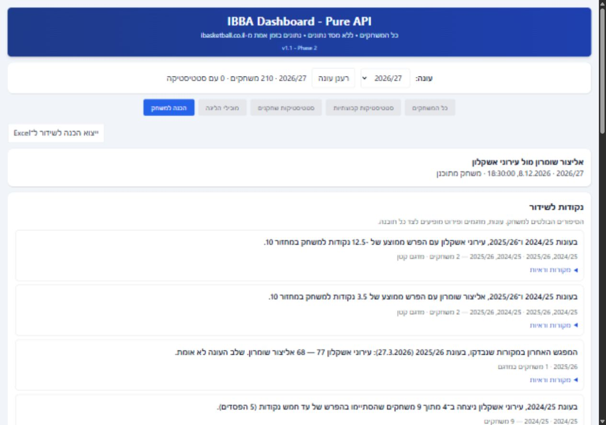
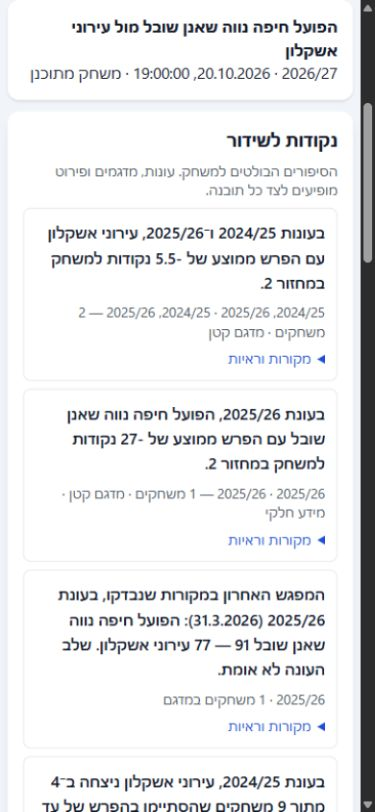

# QA — תובנות עשירות להכנה לשידור

6.10.2026 · בדיקה מקומית ב־localhost:8000 · בסיס השינוי add7b02.

## היקף המימוש

שש משפחות: מחזורים ושלבים, התפתחות ומומנטום, סגנון ובית/חוץ, משחקים צמודים ורבעים, יריבות ושחקנים. עד שמונה סיפורים בראש הדוח; כל התובנות זמינות בקבוצות ובסינון. החלפת ניסוח שומרת עובדות, משפחה ומיקוד.

היסטוריית השחקנים מקובצת לפי זהות רשמית: 538 רשומות עונתיות מהמקור הפכו ל־400 שחקנים בחיפוש. חיפוש ״אליצור״ החזיר 61 שחקנים: 25 בעמוד הראשון, 25 בשני ו־11 בשלישי. אין טבלת מאגר כברירת מחדל או עמודת מקור. פירוט עונות וקבוצות נשמר, והייצוא כולל רק היסטוריה שנבחרה.

## בדיקות אוטומטיות

`npm run check`: 18 קבוצות בדיקה, תחביר 51 קובצי JavaScript וסקריפט HTML אחד. נבדקו ערכי מקור, דקות, אפס מפורש/חסר, משחקים כפולים, תוצאה ללא שחקנים, חלונות מחזור מול משחקים אחרונים, שחקן שעבר קבוצה, שני צדדים בעלי מכנים שונים, היסטוריה בזמן טעינה, החלפת עונה ומשחק בזמן בקשה/ייצוא, וסגל חסר.

בדיקות הרגרסיה נכתבו ונראו נכשלות לפני התיקונים. סקירה עצמאית נערכה בטווח add7b02..2688c45; לא נמצאו ממצאים קריטיים. שמונת הממצאים המהותיים תוקנו ונבדקו שוב:

1. משחק נדחה נכנס לחלון כרונולוגי במקום לחלון המחזורים המקביל. שני הצדדים משתמשים כעת באותו טווח מחזורים.
2. חלונות רחבים היסטוריים אוחדו בין שנים. ההשוואה נפרדת לכל עונה; איחוד נשאר למדגם המחזור הקטן בלבד.
3. הופעת אפס של שחקן נוצרה מהנתונים לתאימות. סיפורי שחקן דורשים הופעה וניקוד מאומתים.
4. מדגם היריבה בשילוב סגנונות השתמש במדד הצד הראשון. המדד, המדגם ומצב הזמינות נשמרים לכל צד.
5. שינוי במפגשים השתמש בשלבים לא מאומתים. מגמה נבנית ממפגשי עונה סדירה מאומתים בלבד.
6. אפס שינוי ו״עלייה של 0״ הפכו לסיפורים. פערים המתעגלים לאפס מסוננים; השוואה לליגה מתוארת כפער.
7. הוספה/הסרה וגישור מאוחר איבדו מיקוד. נשמרים חיפוש, עמוד ומיקוד; מוצגים טעינה והצלחה.
8. חלונות השוואה חתוכים נשאו תיאור של עונה שלמה/עשרה משחקים. לכל חלון מזהי משחקים, מכנה ותאריכים משלו.

בדיקות חיות חשפו ותיקנו גם: תגי מדגם שגויים במשחקים צמודים, זמינות רבעים/תרומה נגזרת, פירוש קליעות שדה, ותובנות V2 ללא מזהה שהתאחדו לפריט יחיד. בבדיקת תוצאות זמניות נשמרו כל 21 תובנות V2, וכל 358 התובנות לפני בחירת שחקן היו נגישות במשפחות הנתמכות. בדיקות נוספות מאמתות שהיסטוריית המסך והייצוא מתעדכנת מאותה תמונת נתונים ברענון, ושגישור רשמי מאוחר של זהות שחקן אינו מכפיל בחירה או מונע הסרה.

## בדיקות בדפדפן

| תרחיש | ממצא |
| --- | --- |
| 2026/27 | 210 משחקים מתוכננים; 0 משחקים עם סטטיסטיקה; הכנה זמינה ללא ניתוח עונתי |
| 2025/26 | 281 משחקים עם סטטיסטיקה; סטטיסטיקות שחקנים וקבוצות זמינות; הכנה חסומה |
| 2024/25 | 244 משחקים עם סטטיסטיקה; 14 קבוצות; בני כפר קאסם מזוהה בשם ההיסטורי; הכנה חסומה |
| מחזורים 1, 2, 10, 25 | ממוצעי מחזור, סיפורי עבר וחלונות מתאימים; מדגם קטן/כיסוי חסר מסומנים |
| מעבר מהיר 2025/26 → 2024/25 → 2026/27 | העונה האחרונה שנבחרה נשארה פעילה בזמן טעינת שמות |
| החלפת ניסוח | משפחת ROUND ומיקוד כפתור נשמרו; עובדות לא השתנו |
| בחירת אביב שמעוני | שתי עונות ושתי קבוצות היסטוריות; הוספה/הסרה עם הודעת הצלחה ומיקוד |
| מקור 2024/25 שנכשל במכוון | הוצג כשל מקומי, מידע מהעונה השנייה נשאר זמין, והניתוח הנוכחי הישן הוסר |
| ניסיון חוזר וסיום נקי | שני מקורות המשחקים ושני מקורות סיכומי השחקנים חזרו למצב ready; לאחר רענון הגרסה הסופית הוצגו 213 תובנות היסטוריות למחזור 10, ללא תוצאות או החלפות שירות לבדיקה וללא שגיאות בקונסול |
| תוצאות זמניות לעונה החדשה | 80 משחקי בדיקה עם סימון QA, לצורך ניתוח עונתי ו־V2; ללא שמירה במקור או באתר |
| רוחב 390 פיקסלים | RTL, טקסט קריא; רוחב המסמך 375 ורוחב הדוח 359; אין גלישה לרוחב העמוד |

בדיקות מקלדת בוצעו דרך Enter, חיפוש, עימוד, הוספה/הסרה והחלפת ניסוח. בטבלת פירוט העונות קיימת גלילה פנימית עם מיקוד וכותרות. לא בוצעה בדיקה עם תוכנת קורא מסך חיצונית.

## Excel

נוצרה חוברת בדיקה בגודל 1,710,951 בתים, גיליון ״הכנה למשחק״, 486 שורות. היא נקראה בחזרה באמצעות XLSX ו־JSZip:

- `rightToLeft="1"` אומת ב־XML של הגיליון.
- משפט השוואת שלב, העובדות ושני המדגמים תואמים לדוח.
- מקטע היסטוריית השחקנים מכיל רק אביב שמעוני: 2024/25 באליצור שומרון (32 משחקים), ו־2025/26 בהפועל מגדל העמק/יזרעאל (29).
- שמירת קובץ הבדיקה לתיקיית ההורדות נחסמה במכוון. יצירה וקריאה חוזרת אומתו; השלמת הורדה בפועל לא אומתה.
- בדיקת Node מאמתת תמונת דוח יציבה אם משתנים המשחק או העונה בזמן יצירת ה־ZIP.

## אימות מקור והגבלות

[מיפוי ואימות המדדים](2026-10-06-rich-insights-source-metrics.md) כולל רשומת מקור מצומצמת מאירוע 993045. השדות fgm/fga הם זריקות לשתיים; בסיפור קליעה מהשדה מחושבים גם הסלים והניסיונות לשלוש. תוויות המסלול הישן תוקנו ל־2PT% בלי לשנות את חוזי החישוב שלו.

ממוצע המחזור הראשון של אליצור שומרון: 76 ו־74 נקודות בשתי העונות = 75; הספיגה 101 ו־79 = 90. במחזור 10 נבדק גם ממוצע 80.5 נקודות לעירוני אשקלון. שחקן שעבר קבוצה נבדק לפי מזהה רשמי ופירוט עונתי, ולא לפי שם.

היסטוריה נטענת בזמן שימוש. היעדר קבוצה, מחזור או שדה אינו מושלם באפס; גם הצלחת בקשות אינה הוכחה לשלמות המדגם. אימות מחזור 2026/27 חל על 210 אירועי הלו״ז שנדגמו ב־6.10.2026; אירועים חדשים דורשים אימות נוסף. אין עדיין תוצאות חיות לעונה זו, ולכן בדיקות הניתוח הנוכחי הן בדיקות מבוקרות בלבד.

## החלטות ביצוע

- נשמרה העבודה באותו checkout ובענף codex/local-hardening; שינויים לא קשורים לא צורפו. עלות ההחלטה: שילוב בענף אחר הוא שלב עתידי.
- ledger מקומי ב־Windows החליף כלי Bash של ה־skill; בדיקות וקומיטים מתועדים בנפרד. עלות: מעקב ידני במקום כלי העזר.
- מפרט ההשוואה לפי עונה גבר על איחוד חלונות רחבים בתכנית. עלות: יותר סיפורים, ללא ממוצע רב־שנתי מטעה.
- ממצאי דיוק שהסקירה כינתה קטנים שולבו בתיקוני החוזים: דקות, כיסוי עצמאי, קבוצה היסטורית במדגם, רבעים ומכנים. עלות השמטתם הייתה תווית או נתון שגויים.
- אימות השדות וה־UI שהסוקר השאיר למממש בוצע מול API ודפדפן חיים. בדיקת קורא מסך והורדה בפועל נשארו מחוץ לאימות שנעשה.
- נשמר מנוע הניתוח הקיים ותוקן שער זמינות השחקנים; לא בוצע עיצוב מחדש של כלל הניתוחים. עלות: גלאים ותיקים שומרים על היקפם הקודם.
- לא בוצעו פרסום, push, merge או שינוי הרשאות proxy. פרסום הוא שלב נפרד.

## צילומי מסך

