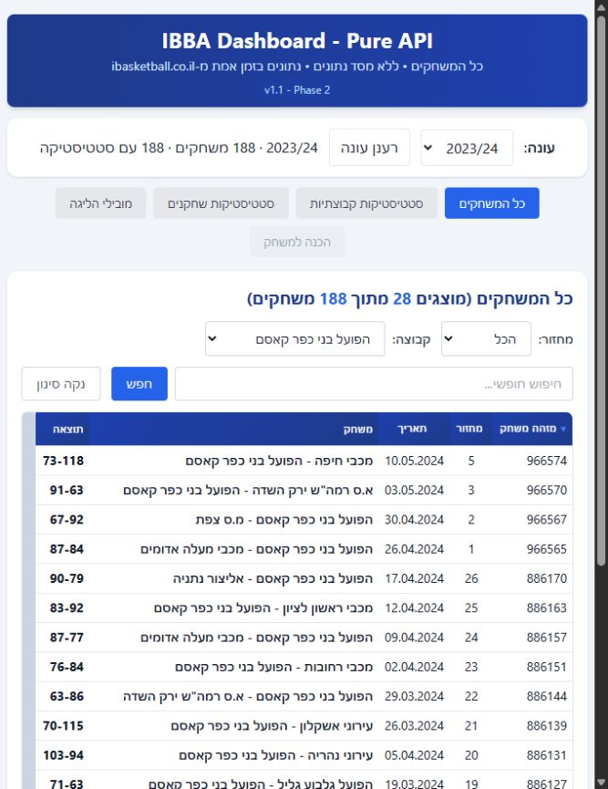

# הוספת עונת 2023/24 — אימות מקומי

מקור: [דף הליגה הרשמי](https://ibasketball.co.il/league/2023-2-%d7%9c%d7%90%d7%95%d7%9e%d7%99%d7%aa/), נבדק ב־6.10.2026.

## הגדרות שאומתו

- ליגה 18586, עונה 18583: מתוך כתובת `data-ajax-url` של טבלת המשחקים בדף.
- טבלה סדירה 881046: האפשרות ״רגילה״ בבורר הטבלאות. 26 מחזורים סדירים, 156 משחקים ו־24 משחקים לכל קבוצה בגלל מחזורי מנוחה. טבלת המשחקים אימתה גם אירועי מחזור 26, למשל 886167–886172. שלבים מאוחרים אינם מסומנים כמחזורים סדירים.
- בני כפר קאסם: מזהה 596704. אירוע 886018 מ־28.11.2023 כולל את המזהה אך מחזיר שם בית ריק. [קישור המשחק הרשמי](https://ibasketball.co.il/match/657669-%d7%94%d7%a4%d7%95%d7%a2%d7%9c-%d7%91%d7%a0%d7%99-%d7%9b%d7%a4%d7%a8-%d7%a7%d7%90%d7%a1%d7%9d-%d7%90%d7%9c%d7%99%d7%a6%d7%95%d7%a8-%d7%a9%d7%95%d7%9e%d7%a8%d7%95%d7%9f/) משמר את השם ״הפועל בני כפר קאסם״. תוצאה: 77 לקאסם, 87 לשומרון. השלמת השם מוגבלת לעונות 2023/24 ו־2024/25 ורק למזהה זה; שם מקור תקין נשמר.

## מה נוסף

העונה זמינה בבורר ובקישור ישיר `?season=2023-24`. שירותי המשחקים, סיכומי השחקנים והקבוצות והתובנות צורכים את ההגדרה המשותפת. היסטוריה כוללת רק עונות קודמות לעונה שנבחרה. הכנה למשחק נשארת זמינה רק לעונת 2026/27 ולמשחקים עתידיים.

המסלול הכללי של האיגוד מחזיר רשימה ריקה לעונה זו; מסלול החודשים הקיים טען 188 משחקים, כולם עם סטטיסטיקה, מ־13 קבוצות. הטעינה הסתיימה ללא חודשים שנכשלו. 28 משחקים של בני כפר קאסם מוצגים בשמה; אין קבוצות Unknown או ״ללא שם״ בעונה שנבדקה. מסכי סטטיסטיקות קבוצות ושחקנים נפתחו: 13 קבוצות ו־186 שחקנים עם נתוני משחק.

## בדיקות

בדיקות העונה והבקשות נכשלו לפני המימוש ועברו לאחריו. נבדקו פרמטרי המקור, גבול מחזור 26/27, השלמת שם הקבוצה, URL, מניעת הכנה היסטורית וטעינת ההיסטוריה מהעונה הנוספת. בדיקות שהניחו שתי עונות קודמות עודכנו לשלוש ולחיפוש לפי מפתח עונה. ההנחה הראשונית של 24 מחזורים תוקנה לאחר אימות טבלת המשחקים, ובדיקה נראתה נכשלת לפני תיקון הגבול.

טעינת סיכומי העונה נתקלה ב־403: כתובת הליגה המקודדת חסרה ברשימת ה־proxy. נוספה הכתובת המדויקת של דף 2023/24 בשרת המקומי וב־API לפרסום. בדיקת שני המסלולים נכשלת לפני התיקון ומאמתת הצלחה לאחריו, לצד חסימת מארחים ונתיבים אחרים. אין היתר כללי לכתובות מקודדות נוספות.

לאחר הפעלת השרת מחדש וניסיון חוזר כל ששת מקורות המשחקים וסיכומי השחקנים משלוש עונות העבר הגיעו למצב ready. נטענו 204 רשומות סיכומי שחקנים מ־2023/24 ו־12 סיכומי קבוצות בעלי קישור פרופיל רשמי. לקבוצה המחוקה אין קישור פרופיל תקף בסיכום הרשמי; לא הומצא עבורה סיכום עונתי. נתוני המשחקים והסטטיסטיקה שלה זמינים במסלול המשחקים. תובנת המחזור הראשון של אליצור שומרון כוללת 2023/24: 87, 76 ו־74 נקודות בשלוש העונות — ממוצע 79.

באימות הגרסה הסופית בדפדפן: 156 משחקים סדירים מאומתים, מהם שישה במחזור 26; 204 רשומות שחקנים מ־2023/24; כל ששת המקורות במצב ready. נתוני הייצוא כוללים את העונה החדשה ולא נמצאו שגיאות בקונסול. `npm run check` עבר בכל 19 קבוצות הבדיקה, עם תחביר 51 קובצי JavaScript וסקריפט HTML אחד.

אין תלויות חדשות. הנתונים ממשיכים להיטען מהמקור בזמן השימוש; אין ארכיון עצמאי. לא בוצע פרסום.

