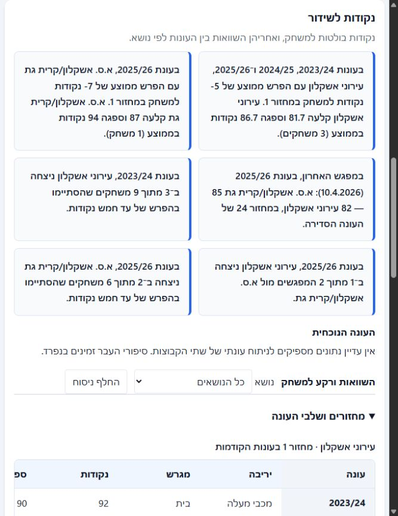
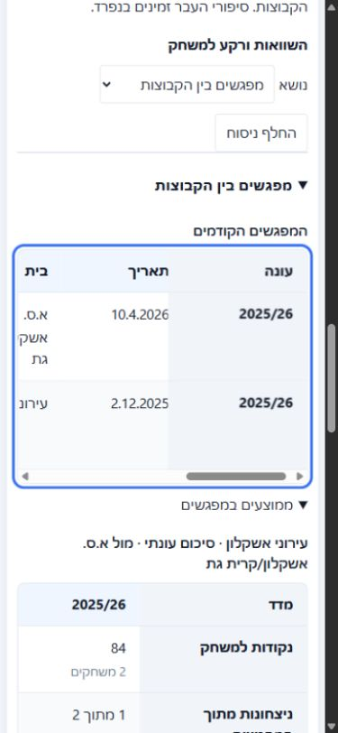
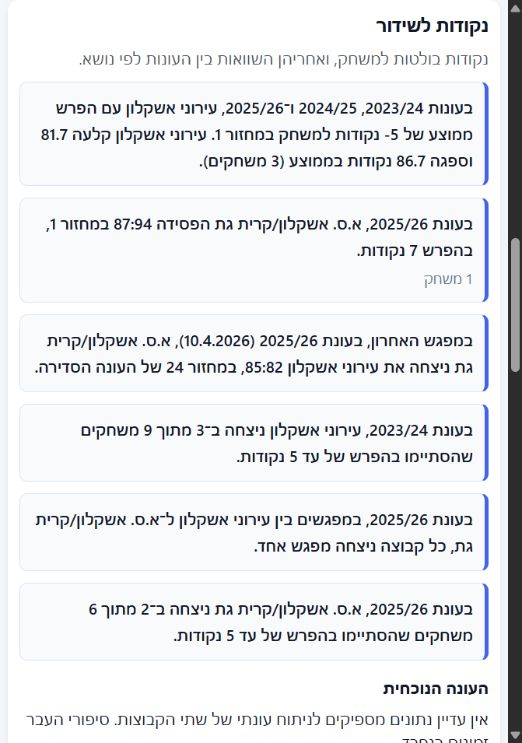
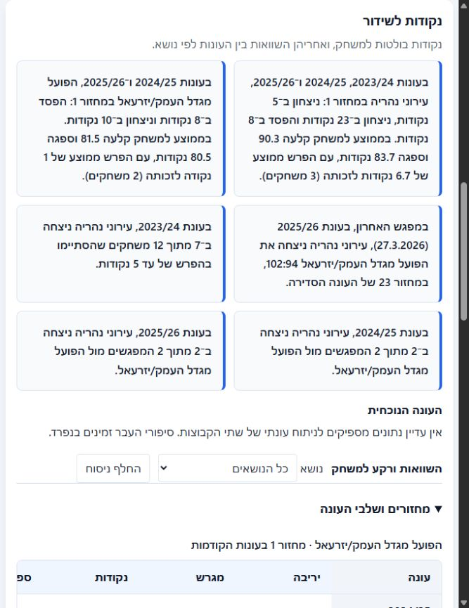

# QA — הכנה לשידור, היסטוריה ומעבר עונות

תאריך: 7.10.2026. סביבת בדיקה: האתר המקומי, `http://localhost:8000`, ארבע העונות 2023/24–2026/27. השינויים מקומיים; פרסום האתר הוא שלב נפרד.

### Overall assessment

התקלות העיקריות היו בחיבור בין הנתונים לתצוגה: אימות המחזור לא הועבר לכל המשחקים, מעבר עונה החזיר תמיד למסך המשחקים, וכל מדד היסטורי קיבל כרטיס נפרד. אלה תוקנו. סדר העבודה כעת: בחירת משחק, פרטי המשחק, נקודות בולטות לשידור, השוואות לפי נושא, וחיפוש שחקנים.

הבדיקות כוללות התנהגות בדפדפן עם נתונים אמיתיים, בדיקות כשל מבוקרות, בדיקות רגרסיה וסקירת קוד עצמאית. אין בכך הבטחה להיעדר כל באג אפשרי או לאמינות נתון שגוי אצל המקור.

### Main issues

| Severity | Area | Problem | Why it matters | Recommended fix |
| --- | --- | --- | --- | --- |
| **High** | מעבר עונות | תמיד נפתח מסך כל המשחקים; תגובות מאוחרות עלולות להגיע לאחר הבחירה | מפריע לעבודה ומסכן ערבוב בין עונות | תוקן: שימור המסך, איפוס מידע קודם ובדיקת גרסת טעינה |
| **High** | אימות מחזור | המפגש האחרון סומן כשלב לא מאומת גם כאשר המחזור מאומת | פוגע באמון בנקודה לשידור | תוקן: העברת האימות גם למשחקי תוצאה; הצגת מחזור רק כשהוא מאומת |
| **High** | מיון סיכומי קבוצות | במצב סה״כ המיון השתמש בשדות הממוצעים | סדר הטבלה לא תאם לערכים המוצגים | תוקן: מיון לפי שדות הסיכום המתאימים |
| **High** | התאוששות מכשל | הודעת הכשל החליפה את רכיבי התקדמות הטעינה | ניסיון חוזר עלול להיכשל במקום להתאושש | תוקן: אזור שגיאה נפרד וכפתור ניסיון חוזר |
| **Medium** | עומס תובנות | כרטיסים חוזרים לכל מדד ולכל עונה | קשה לאתר נקודה לשידור | תוקן: עד שש נקודות בולטות, סיכום מחזור משולב לכל קבוצה, וטבלאות השוואה בין העונות |
| **Medium** | מפגשים | 12 כרטיסי מדדים במקום שני משחקים בפועל | כמות התוכן נראית כמו כמות מפגשים | תוקן: שורה אחת לכל מפגש; ממוצעים ומאזן בתוך פירוט נפרד |
| **Medium** | ניסוחים | שנים כפולות, הפסדים מיותרים, תוויות מדגם ופרטי ראיות בכל כרטיס | עומס טכני ומלל שאינו מתאים לשידור | תוקן: ניסוחים טבעיים, מספר המשחקים נשמר, וראיות נשמרות בנתוני הייצוא |
| **Medium** | RTL | מספר שלילי עשוי להופיע בסדר הפוך | משמעות הנתון אינה ברורה | תוקן: בידוד מספרים, תאריכים ואחוזים בכיוון LTR בתוך עברית |
| **Medium** | זרימת הכנה | הדוח הוצג מעל אזור בחירת המשחק | אין סדר עבודה ברור | תוקן: הבורר נמצא ראשון, הדוח מתחתיו |
| **Medium** | לוח משחקים | משחקי 2026/27 הוצגו מהסוף להתחלה | קשה להגיע למשחק הקרוב | תוקן: מיון ראשוני לפי תאריך עולה |
| **Medium** | שמות ומסנני שחקנים | העשרת שמות איטית עדכנה את המסך רק בסופה ואיפסה את בחירת הקבוצה | קשה לעבוד בזמן הטעינה | תוקן: עדכונים הדרגתיים ושימור מסנן תקף; תגובות ישנות אינן משנות עונה חדשה |
| **Medium** | היסטוריית שחקנים | חיפוש ריק הציג אפס שחקנים למרות היסטוריה טעונה | נראה שאין מידע | תוקן: מספר השחקנים הזמינים לחיפוש, ללא הצפת כל הטבלה |
| **Medium** | המשך העונה | ״המפגש האחרון״ התעלם ממפגש חדש בעונה הנוכחית | עלול לסתור את טבלת המפגשים | תוקן ונבדק: הכללת מפגשי העונה הנוכחית שהושלמו לפני מועד ההכנה |
| **Medium** | כשל מקור | הסרת תוויות הכרטיסים עלולה להסתיר כשל בטעינת העונה הנוכחית | המשתמש לא יודע שלא כל המידע נטען | תוקן: הודעה מעשית אחת לכל עונה שנכשלה, ללא שגיאות טכניות חוזרות |

### Recommended design direction

תדריך קצר תחילה, ופירוט לפי צורך. השנים מופיעות בכותרות הטבלה; כל מדד בשורה אחת, לצד מספר המשחקים ששימשו לו. מפגשים מציגים משחקים אמיתיים בלבד. חיפוש שחקנים מציג זהות אחת עם פירוט העונות והקבוצות, בלי להניח שייכות לסגל הנוכחי.

טבלאות רחבות גוללות בתוך מסגרת עם עמודה ראשונה קבועה. אין גלילה אופקית של הדף. נוספו סימוני מיקוד למקלדת ושמות נגישים למסננים. במובייל גובה פקדים מינימלי הוא 44 פיקסלים.

### Implementation prompt

לבדיקת קבלה: פתחו 2026/27 ובחרו עירוני אשקלון מול א.ס. אשקלון/קרית גת במחזור 1. ודאו שהבורר מעל הדוח, שסיכום אשקלון כולל הפרש ‎-5 לצד 81.7 נקודות ו־86.7 ספיגה בשלושה משחקים, ושבטבלת המפגשים יש שתי שורות. עברו בין מסכי הסטטיסטיקה ובין עונות בלי לאבד את המסך. בדקו מחזור מתקדם, חיפוש והוספת שחקן, ניסיון חוזר לאחר כשל וייצוא. כל שינוי נוסף חייב לשמר מספרי משחקים, זהויות מאומתות והפרדה בין העונה הנבחרת להיסטוריה.

## בדיקות שבוצעו

| תחום | בדיקה | תוצאה |
| --- | --- | --- |
| בדיקות אוטומטיות | `npm run check` לאחר תיקוני סקירת הקוד | 20 קבוצות בדיקה עברו; תחביר 52 קובצי JavaScript וסקריפט HTML אחד עבר |
| TDD | בדיקות רגרסיה חדשות לפני התיקונים | נצפה כישלון הבדיקה ואחריו מעבר עבור התנהגויות המיון, התצוגה, העשרת השמות וממצאי הסקירה |
| משחקים | סדר כרונולוגי 2026/27; סינון מחזור וקבוצה יחד ב־2025/26 וניקוי | תקין; ניקוי החזיר 281 משחקים |
| עונות | 2023/24, 2024/25, 2025/26 ו־2026/27; קישור ישיר, רענון, מעבר מהיר | טעינה תקינה; המסך הנבחר נשמר; תגובה קודמת לא דרסה עונה חדשה |
| כשל עונה | כשל טעינה מבוקר ב־2024/25 ולחיצה על ניסיון חוזר מול מקור אמיתי | רכיבי הטעינה נשמרו; התאוששות ל־244 משחקים ולמסך שנבחר |
| קבוצות | חיפוש אשקלון, ממוצעים/סה״כ ומיון נקודות עם Enter | מיון תואם לערכים; גם אפס תקין אינו מוחלף בשדה אחר |
| שחקנים | מסנן קבוצה, סה״כ, חיפוש פולג, ניקוי ופתיחת היסטוריה | מסנן נשמר; ניקוי מחזיר את כלל השחקנים; פתיחת שחקן ומעבר עונה אינם משאירים פרטים ישנים |
| מובילים | מעבר בין עונות עם נתונים ועונת 2026/27 הריקה | הנתונים מתחלפים; אין מובילים ישנים או דירוגי אפס בעונה הריקה |
| הכנה | המשחק המבוקש במחזור 1; משחקים במחזורים 10 ו־30 | דוחות נבנים בלי סטטיסטיקה נוכחית; היסטוריה מוגבלת לעונות קודמות ולחלונות המתאימים |
| בחירה ידנית | עירוני אשקלון מול א.ס. אשקלון/קרית גת | נמצא משחק עתידי; בחירת אותה קבוצה בשני הצדדים חסומה |
| פעולות דוח | החלף ניסוח, מסנן נושא, פתיחת ממוצעי מפגשים, רענון לוח | מספרים נשמרים; נושא נבחר נשמר בהחלפת ניסוח; רענון הלוח פועל |
| היסטוריה | חיפוש פולג, הוספת עומר פולג לדוח לאחר אימות פרופיל | סיפורים אישיים משתי עונות וקבוצות שונות; ללא הנחת סגל נוכחי |
| היסטוריה — מצבי קצה | חלוקה לעמודים, ערכים חסרים, הוספה/הסרה, כשל וניסיון חוזר | מכוסים בבדיקות Node; אין חיבור לפי שם בלבד |
| תצוגת כשל בדוח | שתי תקלות של אותה עונה הוזנו זמנית והוסרו | הודעה אחת לעונה; הדוח המקורי הוחזר בסוף הבדיקה |
| Excel | יצירת קובץ אמיתי מתוך הדוח ובדיקתו בזיכרון | 184 שורות; כל הנקודות הבולטות וכל התובנות תואמות לדוח; עונה ומשחק נכונים; גיליון RTL |
| מובייל | 390×844, מסכי שחקנים והכנה, גלילת טבלה במקלדת | אין גלישת הדף; גלילה פנימית ומיקוד נראים; כותרות ופקדים קריאים |
| מסך רחב | 1280×900, סדר הבורר/הדוח וטבלת מפגשים | תקין; גודל הדפדפן הוחזר בסוף הבדיקה |
| סקירת קוד | סקירה עצמאית, תיקון שלושה ממצאים ובדיקה חוזרת | לא נמצאו ממצאים מהותיים נוספים בתיקונים שנבדקו |

## אימות הדוגמה ומגבלות הבדיקה

מחזור 1 של עירוני אשקלון: 92–90 ב־2023/24, 65–78 ב־2024/25 ו־88–92 ב־2025/26. לכן ההפרש הממוצע הוא ‎-5, הנקודות 81.7 והספיגה 86.7. המפגש האחרון מול א.ס. אשקלון/קרית גת הוא 85–82 ב־10.4.2026, מחזור 24 מאומת; לפניו 86–82 ב־2.12.2025, מחזור 9. הנתונים אומתו מול רשומות המקור שטען האתר.

לא נמצא חיבור רשמי של זהות א.ס. אשקלון/קרית גת לעונות המוקדמות, ולכן לא נוספו מפגשים לפי דמיון שם. עונות בעלות פחות מחזורים מציגות רק את המשחקים הקיימים ואת מספרם; לא נוצרים משחקים או ממוצעי אפס למחזור חסר.

כלי הדפדפן המשולב לא החזיר אירוע הורדת Excel. במקום זאת נבדק קובץ ה־XLSX המלא שיצר מסלול הייצוא, כולל התאמת התוכן ו־RTL. שמירה בפועל דרך Chrome ופתיחה ביישום Excel אינן חלק מהאימות שבוצע כאן. העיכוב בטעינת חלק משמות השחקנים תלוי בבקשות פרופיל למקור; התצוגה כעת מתעדכנת בהדרגה.

## תיעוד חזותי

## המשך — ניסוחים לשידור

בעקבות בדיקת המשתמש תוקנו הניסוחים: סיכום מחזור עם משחק יחיד מציג תוצאה והפרש ללא ״ממוצע״; המפגש האחרון מציין מנצחת, יריבה ותוצאה בסדר מנצחת:מפסידה; מאזן מפגשים שווה מציין שכל קבוצה ניצחה אותו מספר משחקים, ומאזן לא שווה מציין את הקבוצה עם יותר ניצחונות. סף המשחקים הצמודים וחלונות 5 המשחקים נכתבים בספרות.

נתון החזרה מפיגור מציין במפורש שהקבוצה פיגרה בסיום לפחות רבע אחד, אך ניצחה בסיום המשחק. המכנה הוא כלל המשחקים עם נתוני רבעים מלאים; החישוב לא השתנה.

המסלול של תובנות העונה הנוכחית נשמר. בדיקה עם משחקים סינתטיים מ־2026/27 והמנוע המקורי `IBBAInsightsV2` אימתה שתובנת `RISING_STAR` נכנסת לדוח ולייצוא תחת העונה הנוכחית. אין נתונים חיים מ־2026/27 שיכולים לאמת זאת עדיין; כל תובנה תופיע רק כשהנתונים והספים הדרושים לה זמינים. נוספו בדיקות ניצחון של בית ושל חוץ, תיקו במפגשים, רוב ניצחונות לקבוצת החוץ, משחק יחיד לעומת כמה משחקים והחלפת ניסוח.

בדיקת ההמשך המקומית עברה: 20 קבוצות בדיקה, תחביר 52 קובצי JavaScript וסקריפט HTML אחד. בדוח המשחק האמיתי אומתו הניסוחים 87:94, 85:82, מאזן מפגשים שווה ונתון החזרה מפיגור 7 מתוך 36. גם החלפת ניסוח ושימור הנושא נבדקו בדפדפן.

## המשך — תוצאות בפועל לצד ממוצע המחזור

סיכום מחזור משותף לכמה עונות מציג כעת את הניצחונות וההפסדים וההפרש בכל משחק לפני הממוצעים. לדוגמה, הפועל מגדל העמק/יזרעאל הפסידה 73:81 במחזור 1 של 2024/25 וניצחה 90:80 במחזור 1 של 2025/26. לכן הדוח מציין ״הפסד ב־8 נקודות וניצחון ב־10 נקודות״, לצד ממוצעי 81.5 נקודות, 80.5 ספיגה והפרש ממוצע של 1 נקודה לזכותה. אין רושם ששני המשחקים הסתיימו בהפרש נקודה. גם ״נקודה״ ביחיד וכיוון ההפרש לזכות/לחובת הקבוצה תוקנו.

בדיקות רגרסיה מכסות ניצחון ב־30 והפסד ב־28 עם ממוצע 1, ממוצע שלילי, שני ניצחונות, שימור זהות המשחק בכל עונה והופעת אותו ניסוח בייצוא. 20 קבוצות הבדיקה ובדיקת התחביר של 52 סקריפטים וסקריפט HTML אחד עברו. בדפדפן המקומי נבדקו הדוח האמיתי והחלפת הניסוח, בהשוואה לטבלת המשחקים המפורטת.

